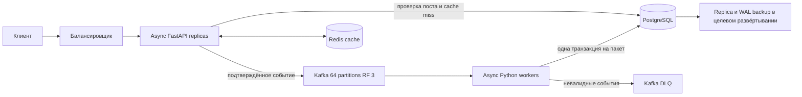
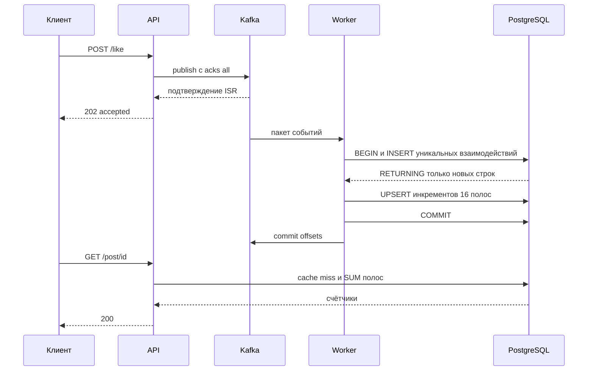

# Счётчики постов с постоянной дедупликацией

Сервис принимает события лайков и просмотров и возвращает агрегированные
счётчики. Python API подтверждает запись в Kafka, асинхронные worker
обрабатывают события пакетами, PostgreSQL обеспечивает дедупликацию и
атомарное обновление агрегатов. Redis ускоряет чтения и может быть потерян
без потери взаимодействий.

## Требования и границы

| Параметр | Значение |
|---|---|
| Приём событий | 20 000 запросов в секунду суммарно для лайков и просмотров |
| Посты | 50 млн |
| Лайк | Один на пользователя и пост за всё время |
| Просмотр | Один на пользователя и пост за всё время |
| Задержка приёма | Принятое допущение p99 ≤ 150 мс |
| Задержка чтения | Принятое допущение p99 ≤ 100 мс |
| Свежесть | Принятое допущение p99 ≤ 2 с в штатном режиме |
| Чтения для расчёта | Допущение 10 000 объектов в секунду |

Снятие лайка, анонимные просмотры, удаление аккаунтов и изменение идентичности
пользователя не входят в контракт инкрементов. Пользователь имеет постоянный
идентификатор. Прототип использует `username`; в целевой системе actor ID
приходит из проверенного токена, а каталог пользователей обслуживается отдельно.

Два срока различаются: HTTP-запрос завершается после сохранения события в
Kafka, а чтение отражает событие после транзакции worker и истечения старого
кэша. Немедленного read-your-writes после `202` контракт не обещает.

Предел 2 секунды относится к штатной работе. При недоступном PostgreSQL
очередь сохраняет события, но свежесть нарушается. Абсолютный предел при
неограниченном сетевом разделении несовместим с продолжением приёма событий.

## Расчёт ёмкости

Для хранения считаем 20 000 RPS непрерывной нагрузкой. Если это только пик,
дисковый объём нужно пересчитать по средней нагрузке.

```text
События за сутки = 20 000 × 86 400 = 1 728 000 000
Среднее сериализованное событие = 200 байт, допущение
Входящий поток Kafka = 4 МБ/с без протокольных накладных расходов
Журнал за сутки = 345,6 ГБ без сжатия
72 часа хранения × replication factor 3 = 3,11 ТБ
```

Kafka provision включает запас на индексы сегментов, свободное место и
перебалансировку. Для этой модели закладываем 5–6 ТБ суммарного пространства
кластера, а экономию от LZ4 подтверждаем реальными данными. Межброкерная
репликация добавляет около 8 МБ/с полезных данных к входящим 4 МБ/с.

50 млн постов не задают число взаимодействий. Дедупликация требует помнить
каждую уникальную тройку `(post_id, user_id, kind)` бессрочно. Обозначим долю
новых уникальных взаимодействий через `f`.

```text
Новых строк за сутки = 1,728 млрд × f
При f = 10%: 172,8 млн строк в сутки
За 90 суток: 15,552 млрд строк
При 140 байт на строку вместе с индексами: 2,18 ТБ на primary
Primary + одна replica: 4,35 ТБ до WAL, backup и эксплуатационного запаса
```

140 байт — оценка, которую проверяют через размеры таблиц и индексов после
загрузки репрезентативных данных. При `f=100%` объём в десять раз больше.
Число пользователей и срок жизни постов также нужны для окончательного sizing.
Постоянную точную дедупликацию нельзя заменить TTL без изменения требований.

Два 64-битных числа для 50 млн постов занимают 0,8 ГБ полезных данных.
Для распределения записи используем до 16 строк счётчиков на пост:
максимум 800 млн строк. При оценке 96 байт на строку с индексом это около
76,8 ГБ на primary. Строки создаются по мере взаимодействий.
Тексты постов относятся к каталогу постов; их объём считают отдельно.

## Архитектура



В Compose работают один API, один worker, PostgreSQL, Redis, три брокера Kafka
и однократный job миграции. Брокеры на одном ноутбуке проверяют протокол
отказа одного процесса, но не защищают от отказа самого ноутбука.

## Контракт API

| Метод и путь | Назначение | Успешный ответ |
|---|---|---|
| `POST /post/` | Создать учебный пост | `201`, `id`, `content` |
| `GET /post/?after_id=0&limit=20` | Посты по курсору, limit ≤ 100 | `200`, список |
| `POST /like` | Принять лайк | `202`, `event_id`, `post_id`, `status` |
| `POST /view` | Принять просмотр | Такой же `202` |
| `GET /post/{id}` | Пост и счётчики | `200`, `post_id`, `content`, `likes_count`, `views_count` |

Тело инкремента прототипа:

```json
{"post_id": 42, "username": "alice"}
```

`404` означает неизвестный пост, `422` — неверный вход, `429` — заполненный
буфер публикаций API, `503` — отсутствие подтверждения Kafka в срок.
После таймаута результат может быть неопределённым: событие могло попасть в
Kafka. Повтор запроса безопасен благодаря постоянной бизнес-дедупликации.
Повтор уже учтённого взаимодействия также получает `202`: API не делает
синхронную проверку дедупликации перед очередью. Настройки подтверждения
описаны в [Kafka Producer Configs](https://kafka.apache.org/41/configuration/producer-configs/).

Идентификатор `event_id` нужен для трассировки. Два разных event ID одной
тройки всё равно учитываются один раз.

## Модель данных и алгоритм

```text
posts(id BIGINT PK, content TEXT)
users(id BIGINT PK, username VARCHAR(128) UNIQUE)
likes(id BIGINT PK, post_id BIGINT, user_id BIGINT, UNIQUE(post_id, user_id))
views(id BIGINT PK, post_id BIGINT, user_id BIGINT, UNIQUE(post_id, user_id))
post_counters(post_id BIGINT, stripe INT, likes_count BIGINT, views_count BIGINT,
              PRIMARY KEY(post_id, stripe))
```

Kafka key — сочетание поста и пользователя. Поэтому разные пользователи
популярного поста распределяются по партициям. Партиционирование только по
post ID направило бы весь трафик популярного поста одному consumer.

Worker берёт до 500 событий с ожиданием до 100 мс. В одной транзакции он:

1. Проверяет существование постов и отделяет события для удалённых постов.
2. Создаёт неизвестных пользователей пакетным `ON CONFLICT DO NOTHING`.
3. Вставляет лайки и просмотры с `ON CONFLICT DO NOTHING RETURNING post_id, user_id`.
4. Использует только возвращённые строки для формирования инкрементов.
5. Группирует инкременты по `(post_id, user_id % 16)` и обновляет счётчики.
6. Коммитит PostgreSQL, затем фиксирует Kafka offsets, как требуется для
   [ручной фиксации после обработки пакета](https://aiokafka.readthedocs.io/en/stable/consumer.html#manual-vs-automatic-committing).

Чтение суммирует максимум 16 строк по индексному префиксу post ID.
Оно не выполняет `COUNT` по миллионам взаимодействий популярного поста.
Индексы уникальности начинаются с post ID, поэтому дополнительный одиночный
индекс post ID для взаимодействий избыточен.



Доставка Kafka → worker имеет семантику at-least-once. Эффект в БД
идемпотентен: падение после PostgreSQL commit до offset commit приводит к
повторной доставке, но не к новому инкременту. Ниже этого уровня не требуется
распределённая транзакция Kafka–PostgreSQL. Атомарная гарантия обеспечивается
уникальным ограничением и транзакцией PostgreSQL. Семантика пропуска
конфликта и возвращаемых строк описана в [PostgreSQL INSERT](https://www.postgresql.org/docs/current/sql-insert.html).

Порядок блокировок стабилен: пользователи и пары сортируются, типы обрабатываются
в одном порядке, затем сортируются полосы счётчиков. Это уменьшает вероятность
deadlock между пакетами. Транзакционные ошибки откатывают весь пакет; worker
повторяет тот же пакет и не читает следующий до успешного commit.

## Кэширование и бюджет свежести

Счётчики используют cache-aside с TTL 300 мс. Дедупликация хранится только в
PostgreSQL. Redis не является источником истины и не участвует в транзакции worker.
Положительное существование поста кэшируется отдельно на 30 секунд, поскольку
прототип не предоставляет удаление постов.

При cache miss API читает PostgreSQL primary и заполняет Redis через `SET NX`.
Время выполнения SQL входит в TTL: задержанный результат не может получить
новый полный срок жизни. Чтение кэша не продлевает TTL. Redis имеет короткий
таймаут; при сбое чтение идёт в PostgreSQL. Соединения асинхронного клиента
закрываются через [Redis.aclose](https://redis.readthedocs.io/en/stable/examples/asyncio_examples.html).

| Этап | Проектный бюджет |
|---|---|
| API и подтверждение Kafka | 150 мс |
| Ожидание очереди | 500 мс |
| Набор пакета | 100 мс |
| SQL и commit | 350 мс |
| Старый кэш | 300 мс |
| Сеть и чтение | 100 мс |
| Запас | 500 мс |

Сумма даёт 2 секунды как инженерный бюджет. Сложение бюджетов этапов не
доказывает общий p99: его измеряют отдельным end-to-end пробником.
В метрику `counter_event_apply_seconds` входит задержка до DB commit;
для видимости через API учитывают также TTL и время чтения.

## Масштабирование

Основной тип — горизонтальное масштабирование stateless API и consumer group.
Async освобождает поток во время сетевого ожидания, но не устраняет стоимость
CPU, SQL, индексов и блокировок. Каждый HTTP-запрос и пакет worker используют
свою [AsyncSession](https://docs.sqlalchemy.org/en/20/orm/extensions/asyncio.html).
Число экземпляров определяется замерами:

```text
N ≥ ceil(20 000 / измеренная безопасная производительность экземпляра) + 1
```

64 партиции допускают до 64 одновременно назначенных consumer этой группы.
Средняя нагрузка составляет 312,5 событий/с на партицию. Популярный пост
распределяется по пользователям, а пакетирование сокращает число транзакций:
при полных пакетах 500 это около 40 транзакций/с суммарно. Сами вставки строк
и WAL всё равно остаются пропорциональными числу новых взаимодействий.

В текущем коде все worker пишут в один PostgreSQL primary. Добавление worker
не превращает PostgreSQL в распределённую БД. Сначала проверяем один primary
на NVMe с пакетированием. При росте дискового состояния или исчерпании primary
целевая следующая ступень — логические шарды по хешу пары `(post_id, user_id)`
и распределённые полосы счётчиков. Для этого нужны стабильные ID из внешнего
каталога пользователей, маршрутизация пакетов и fan-out суммирования по шардам.
Эта миграция не реализована в демонстрационном Compose.

При нескольких API нужен внешний балансировщик; опубликованный порт Compose
рассчитан на один API. Worker масштабируются `--scale worker=N` без конфликта
портов. Для отказоустойчивости production PostgreSQL получает standby и WAL
архивирование, а брокеры Kafka размещаются в разных зонах отказа.

## Отказы и восстановление

| Сбой | Поведение |
|---|---|
| Клиент повторил запрос | Новое событие, прежняя уникальная тройка, инкремент не повторяется |
| API упал после Kafka ack до ответа | Клиент повторяет; дедупликация сохраняет результат |
| Worker упал до DB commit | Транзакция откатывается, Kafka доставляет события снова |
| Worker упал после DB commit | Повторная вставка не вернёт строк через RETURNING |
| PostgreSQL временно недоступен | Пакет повторяется с backoff, offsets не фиксируются, lag растёт |
| Redis недоступен | Чтения обходят кэш, worker продолжает работать |
| Один Kafka broker недоступен | RF 3 и min ISR 2 позволяют сохранять события после перевыбора лидера |
| Недостаточно ISR | API не подтверждает успешный приём, возвращает 503 по таймауту |
| Невалидное сообщение | DLQ до фиксации соответствующего offset |
| DLQ недоступна | Offset не фиксируется; после рестарта повтор безопасен для БД |
| Безвозвратно потерян PostgreSQL | Восстановление из backup и WAL, затем replay доступного хвоста Kafka |

Kafka raw retention 72 часа не заменяет backup всей истории дедупликации.
Восстановление пустой БД только из последних 72 часов даст неправильные
счётчики и повторно разрешит старые взаимодействия. Для полного восстановления
нужен backup PostgreSQL, пригодный WAL и соответствующий диапазон Kafka offsets.
После восстановления БД worker останавливают и возвращают offsets к точке,
не позднее восстановленного состояния. Безопасно повторить весь сохранённый
хвост Kafka: старые строки отсеются уникальными ограничениями. Обычный запуск
с прежними, более новыми offsets мог бы пропустить потерянные при restore события.

При переполнении pending publish API возвращает 429. Операторские алерты по
возрасту событий и lag срабатывают до исчерпания 2 секунд. Для строгого отказа
в приёме при деградации нужна отдельная политика admission control по lag;
в прототипе она ограничивает только pending publish, а не возраст очереди.

## Проверка требований и вопросы защиты

Тесты проверяют конкурентную первую запись пользователя, постоянную уникальность,
rollback, повтор пакета после DB commit, обработку отсутствующего поста и
видимость через настоящие Kafka, PostgreSQL и Redis. Небольшой интеграционный
тест с пределом 2 секунды не заменяет нагрузочное подтверждение 20 000 RPS.

Для приёмки нужны одновременно: 20 000 запросов/с без роста lag, p99 HTTP ≤ 150 мс,
p99 чтения ≤ 100 мс и p99 end-to-end ≤ 2 с. Проверяем равномерный трафик,
популярный пост, высокий процент дублей, 100% новых взаимодействий, отказ worker,
отказ брокера и Redis. Проверка больших данных включает индексы на объёме
50 млн постов и реалистичное число взаимодействий, а не только пустую БД.

На защите ключевые ответы:

- Бизнес-дедупликация не равна idempotent producer: клиент может прислать два разных события.
- Точность обеспечивает UNIQUE в PostgreSQL, а не проверка SELECT перед INSERT.
- Кэш удаляется свободно; состояние дедупликации бессрочно и резервируется.
- 16 полос снижают конкуренцию за одну строку; число строк взаимодействий они не уменьшают.
- 202 подтверждает долговечный приём, а не немедленное изменение показанного числа.
- Больше async worker ускоряют работу только до следующего ограничивающего ресурса.
- Bloom filter не может быть единственным источником точной дедупликации из-за false positive.

Результат короткого локального испытания: профиль 1000 RPS на 15 секунд
выполнил 15 001 инкремент без ошибок и dropped iterations, общий HTTP p99
составил 30,74 мс. В конфигурации работали один API и два worker. Это не
подтверждение работы на 20 000 RPS и 50 млн постов; для этих параметров
применяется описанная выше процедура приёмки. Детали окружения и остальных
проверок приведены в [README.md](README.md#результаты-локальной-проверки).

