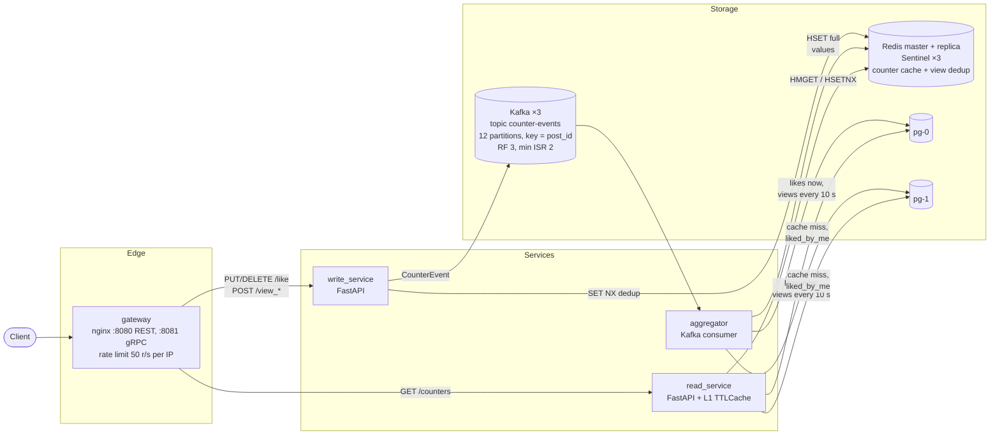
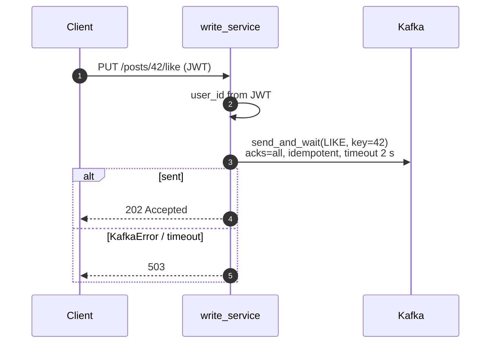
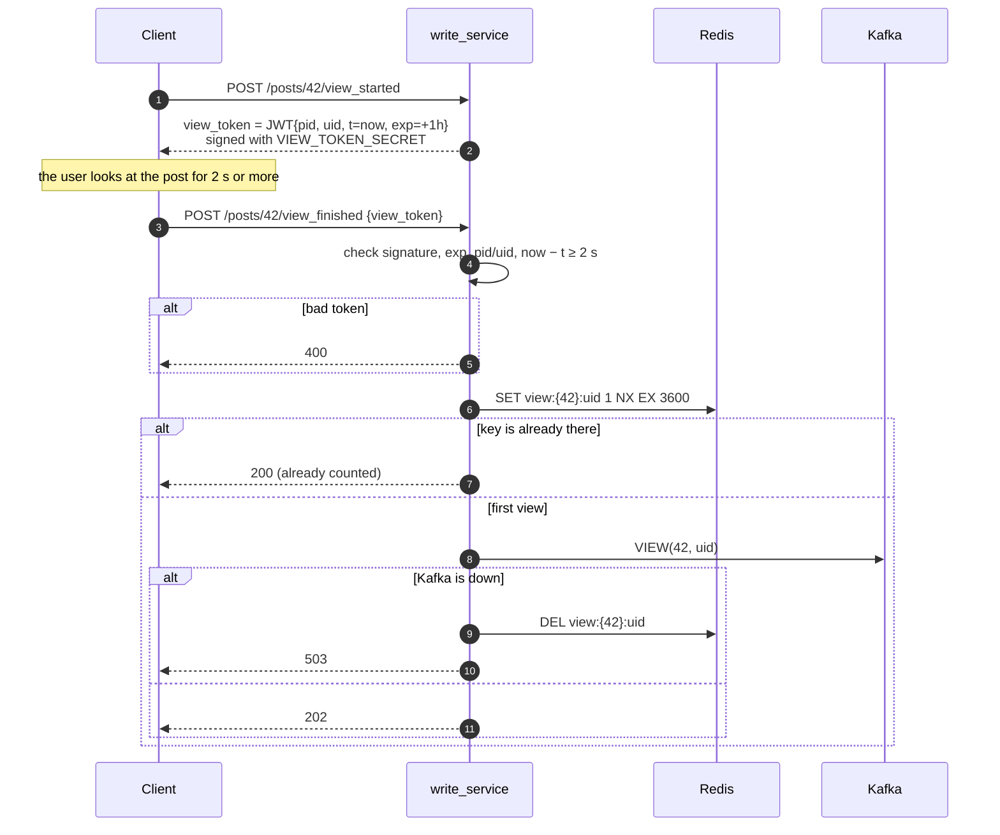
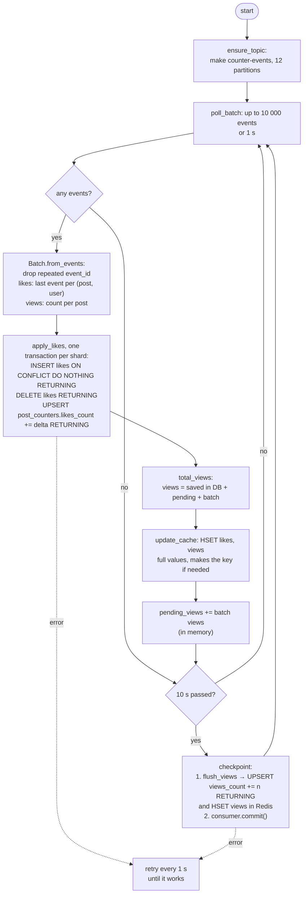
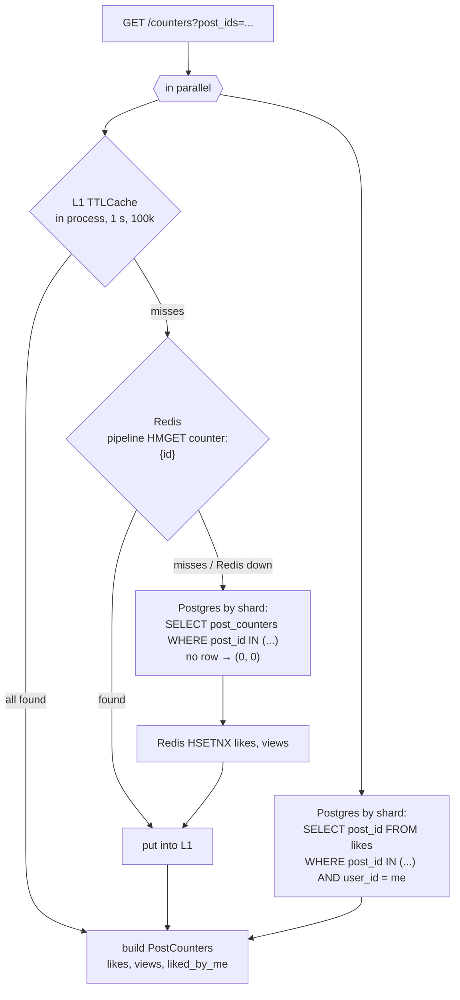
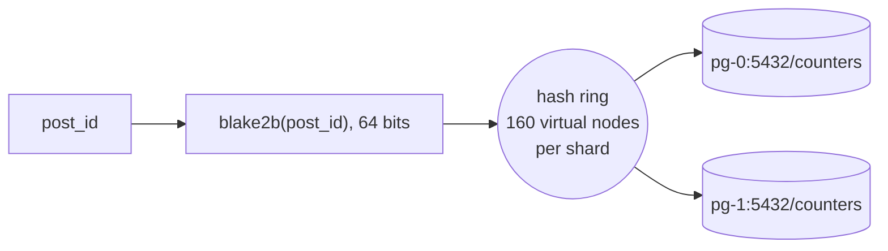
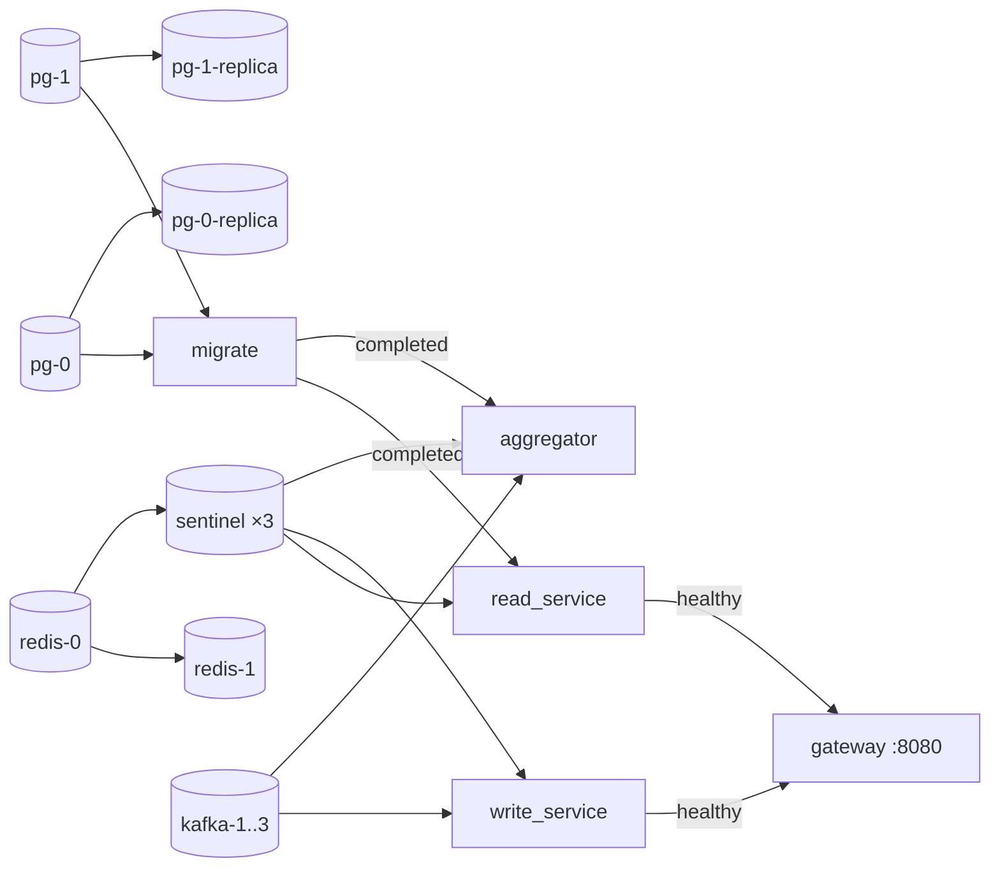

# SIS 2 — Like and View Counter

Stack: Python 3.12, FastAPI, aiokafka, redis-py, SQLAlchemy (asyncpg), Alembic, nginx, Kafka (KRaft) ×3, Redis with a replica and 3 Sentinels, PostgreSQL with 2 shards. Each shard has a replica.
This is one repo with a `uv` workspace: `shared`, three services and migrations.

## Architecture



The idea is CQRS. Writes are async: the service puts an event into Kafka and answers `202`. Reads come from caches.
Counters are eventually consistent. A new like is visible after the next batch (about 1 s). A new view is in Redis after about 1 s too. Views get to Postgres after a checkpoint (about 10 s).

| Part | Code | What it does |
|---|---|---|
| gateway | [services/gateway/nginx.conf](services/gateway/nginx.conf) | The only entry point. REST on `:8080`, gRPC (h2c) on `:8081`. Limit: 50 r/s + burst 100 per IP (`429`) |
| write_service | [services/write_service](services/write_service) | Checks the user, makes view tokens, stops double views, sends events |
| read_service | [services/read_service](services/read_service) | Gives counters: L1 → Redis → Postgres |
| aggregator | [services/aggregator](services/aggregator) | Reads Kafka in batches, writes to Postgres shards and updates Redis |
| shared | [shared/src/shared](shared/src/shared) | Events, models, Redis keys, sharding, JWT, settings |
| migrate | [infra/postgres](infra/postgres) | Runs `alembic upgrade head` on every shard |

## API

Every request needs `Authorization: Bearer <JWT>` (HS256, secret `JWT_SECRET`, `sub` = user id).

| Method | Path | Service | Answer |
|---|---|---|---|
| `PUT` | `/api/v1/posts/{id}/like` | write | `202` |
| `DELETE` | `/api/v1/posts/{id}/like` | write | `202` |
| `POST` | `/api/v1/posts/{id}/view_started` | write | `200 {"view_token": "..."}` |
| `POST` | `/api/v1/posts/{id}/view_finished` | write | `202` counted, `200` already counted, `400` bad token or view < 2 s |
| `GET` | `/api/v1/posts/{id}/counters` | read | `{post_id, likes, views, liked_by_me, unavailable}` |
| `GET` | `/api/v1/counters?post_ids=1,2,3` | read | `{"counters": [...]}`, up to 100 ids |

If Kafka is down, write endpoints answer `503`. The client tries again.

Each post in a read answer has the field `unavailable`. It is `true` only when the post is not in Redis and its shard and the shard replica are both down. Then `likes` and `views` are 0, and you can not trust them. Other posts in the batch come back as usual.

The field `liked_by_me` can be `null`. This means the shard with likes did not answer, so we do not know if the user liked the post.

The header `Idempotency-Key: <UUID>` is optional for writes. With it, a retry is safe: the event gets the same `event_id`, and the aggregator counts it only once.

### gRPC

The same actions work with gRPC on `:8081`: `CounterWriteService` (`Like`, `Unlike`, `ViewStarted`, `ViewFinished`) and `CounterReadService` (`GetCounters`, `BatchGetCounters`).
The contract is [counters.proto](shared/src/shared/proto/counters.proto). Run `make proto` to make the code. The gRPC server starts in the same process as FastAPI (port `50051`). It uses the same service objects.

- The JWT goes in the metadata `authorization`. The idempotency key goes in the field `idempotency_key`.
- The server stops calls to Redis, Kafka and Postgres when the client deadline is over. Then it answers `DEADLINE_EXCEEDED`.
- The client ([load/client.py](load/client.py)) retries `UNAVAILABLE` with `retryPolicy` (exponential backoff) and `retryThrottling`.

Why gRPC, how retries work and the numbers against REST are in [REPORT.md](REPORT.md).

## Like



The message key is `post_id`. So all events of one post go to one partition, and they stay in order.
A second like, or an unlike without a like, is safe. The aggregator uses the primary key `(post_id, user_id)` for this.

## View

A view counts only when `view_finished` comes 2 s or more after `view_started`. One user can add only one view to one post per hour.



The token is stateless. The server does not need to save the start time. If Redis is down, the dedup lets the request pass (fail-open). One extra view is better than an error.

## Aggregator



The checkpoint also runs when partitions move to another instance (rebalance) and on stop (SIGTERM/SIGINT).

### Why counters do not count twice

The Kafka offset is saved **only after** views are written to Postgres. After a crash, the aggregator reads the events again from the last saved offset:

- **Likes.** The table `likes` has the primary key `(post_id, user_id)`. A second `INSERT` adds nothing, `RETURNING` is empty, so `delta = 0`. Redis gets the full `likes_count` from Postgres.
- **Views in Postgres.** `pending_views` was only in memory. It is lost with the process, so the second read writes the views exactly once.
- **Views in Redis.** The aggregator writes the full value, not a plus: `views = saved in Postgres + pending + batch`. It knows the saved part from `RETURNING` at flush time, or it reads it from the DB (LRU for 200k posts). Writing the same value again breaks nothing, so a replay after a crash is safe.
- **The client sends again** (a retry after a lost ack). This is a new message with the same `event_id`. The aggregator keeps an LRU of recent `event_id`s and drops the repeat. After a restart, the replay from the saved offset fills the LRU again.

### Why the cache does not keep an old value

The aggregator always writes `likes` and `views` to Redis, even if there is no key yet. On a cache miss, read_service adds only **missing** fields from Postgres with `HSETNX`. So:

- if the aggregator writes first, `HSETNX` changes nothing;
- if read_service writes an old DB value first, the aggregator writes the full value over it.

Views that are not in Postgres yet go to Redis at once, so a DB read can not lose them. Counters have no TTL. Redis uses `maxmemory-policy volatile-lru`: when memory is full, Redis drops only dedup keys, not counters. A counter key can be lost only when Redis loses data, for example when the newest writes do not reach the replica before a failover. Then the next event for the post or the next flush (≤ 10 s) fixes the value.

When partitions move to another instance (rebalance), the aggregator forgets its cache of saved views. Another instance writes these posts now.

## Read



- L1 helps with hot posts. When one post gets a lot of traffic, Redis gets at most one request per second per instance.
- `HSETNX` adds only missing fields. It never writes over a value from the aggregator.
- A Redis error does not break the request. The service reads from Postgres instead.
- `liked_by_me` always comes from Postgres. We do not cache personal data.
- If the shard primary does not answer in 0.5 s, the read goes to the shard replica. For the next 5 s, the service does not ask the primary ([shared/db.py](shared/src/shared/db.py)). If the replica is down too, `liked_by_me` is `null`, and posts that are not in Redis come back with `unavailable = true`.

## Postgres sharding



- Both tables are split by `post_id`. All data of one post is on one shard, so we do not need transactions across shards.
- `DATABASE_URLS` is the list of shards. The name of a node on the ring is `host:port/db`. This is consistent hashing: when you add a shard, only about 1/N of the posts move.
- `ShardedDatabase.map_shards` groups `post_ids` by shard and runs the queries in parallel.
- Migrations ([env.py](infra/postgres/migrations/env.py)) run on every shard, one by one, with `pg_advisory_xact_lock`.

## Data


| Redis key | Type | TTL | What for |
|---|---|---|---|
| `counter:{post_id}` | hash `likes`, `views` | none, never dropped (`volatile-lru`) | counter cache |
| `view:{post_id}:{user_id}` | string | 3600 s | view dedup |

The curly brackets are a hash tag. With Redis Cluster, all keys of one post go to one slot.
Redis is only a cache (`save ""`, `appendonly no`). The source of truth is Postgres + Kafka.

The Kafka event ([events.py](shared/src/shared/events.py)):

```json
{"event_id": "uuid", "type": "like | unlike | view", "post_id": 42, "user_id": 7, "timestamp": 1761800000000}
```

## Run

```bash
cd sis2
cp .env.example .env        # POSTGRES_PASSWORD, VIEW_TOKEN_SECRET, JWT_SECRET
docker compose up --build
```

`depends_on` and health checks set the start order:



Only `:8080` (REST) and `:8081` (gRPC) are open to the outside.

### Fault tolerance

| Part | Setup | What happens when a node dies |
|---|---|---|
| Kafka | 3 KRaft nodes (broker + controller). The topic has 12 partitions, replication factor 3, `min.insync.replicas=2`. The producer uses `acks=all` | 2 of 3 controllers pick new partition leaders in about 3 s (`broker.session.timeout.ms=3000`). No events are lost |
| Redis | `redis-0` is master, `redis-1` is replica, 3 Sentinels with quorum 2 | Sentinel makes the replica the new master in about 2 s (`down-after-milliseconds 2000`). Services find the new master through Sentinel. With no master, reads go to Postgres, dedup lets requests pass, the aggregator retries |
| Postgres | 2 shards, each has a streaming replica (`pg_basebackup` + `standby.signal`) | Writes wait in Kafka. The aggregator retries until the primary is back. Reads go to the replica. If the primary and the replica are both down, posts of this shard that are not in Redis come back with `unavailable = true` |

Services connect to Redis through Sentinel ([redis_client.py](shared/src/shared/redis_client.py)) with a 0.5 s socket timeout. They connect to Kafka with the list of all brokers.
To test this under load, use [load/failover.py](load/failover.py): `uv run python load/failover.py kafka-2` (or `redis-0`). It kills a node in the middle of a stream of likes. Then it checks that nothing is lost and nothing is counted twice. The compose setup is in [docker-ymls](docker-ymls). All Python images come from one [python.Dockerfile](docker-ymls/dockerfiles/python.Dockerfile) with the args `PACKAGE` and `SRC`.

### Test by hand

```bash
set -a; source .env; set +a
TOKEN=$(uv run -q python -c "import jwt, os; print(jwt.encode({'sub': '7'}, os.environ['JWT_SECRET'], algorithm='HS256'))")
H="Authorization: Bearer $TOKEN"

curl -i -X PUT -H "$H" localhost:8080/api/v1/posts/42/like

VT=$(curl -s -X POST -H "$H" localhost:8080/api/v1/posts/42/view_started | jq -r .view_token)
sleep 2
curl -i -X POST -H "$H" -H 'Content-Type: application/json' \
  -d "{\"view_token\": \"$VT\"}" localhost:8080/api/v1/posts/42/view_finished

sleep 1
curl -s -H "$H" 'localhost:8080/api/v1/counters?post_ids=42,43' | jq
```

## Settings

Common variables (from [services.yml](docker-ymls/services.yml)): `DATABASE_URLS` (comma list), `REDIS_URL` (`redis+sentinel://sentinel-1:26379,.../counters`: the Sentinel list and the master name), `KAFKA_BOOTSTRAP_SERVERS` (comma list), `KAFKA_TOPIC`, `JWT_SECRET`.

| Service | Variable | Default |
|---|---|---|
| write | `VIEW_TOKEN_SECRET` | — |
| write | `VIEW_TOKEN_TTL_SECONDS` | 3600 |
| write | `VIEW_MIN_SECONDS` | 2.0 |
| write | `PUBLISH_TIMEOUT_SECONDS` | 2.0 |
| write | `CHAOS_ACK_LOSS_RATE`: part of Kafka acks to "lose" on purpose, only for [load/chaos.py](load/chaos.py) | 0 |
| write, read | `GRPC_PORT` | 50051 |
| read | `DB_POOL_SIZE` | 20 |
| read | `LOCAL_CACHE_TTL_SECONDS` / `LOCAL_CACHE_SIZE` | 1.0 / 100 000 |
| read | `MAX_BATCH_POSTS` | 100 |
| read | `DATABASE_REPLICA_URLS`: shard replicas, in the same order as `DATABASE_URLS` | — |
| read | `DB_TIMEOUT_SECONDS`: how long to wait for the shard primary before the replica | 0.5 |
| aggregator | `KAFKA_GROUP_ID` / `KAFKA_TOPIC_PARTITIONS` / `KAFKA_REPLICATION_FACTOR` | aggregator / 12 / 3 |
| aggregator | `BATCH_WINDOW_SECONDS` / `BATCH_MAX_EVENTS` | 1.0 / 10 000 |
| aggregator | `FLUSH_INTERVAL_SECONDS` | 10.0 |
| aggregator | `RETRY_BACKOFF_SECONDS` | 1.0 |
| aggregator | `SEEN_EVENTS_SIZE`: LRU size for `event_id` dedup | 200 000 |
| aggregator | `FLUSHED_VIEWS_SIZE`: LRU of view values saved in the DB | 200 000 |
| aggregator | `DB_POOL_SIZE` | 5 |
