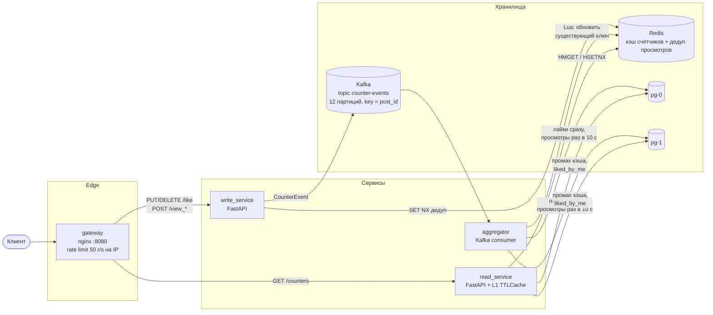
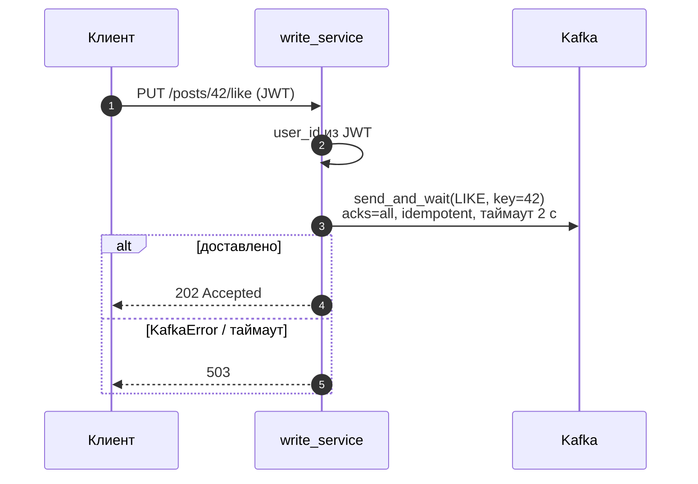
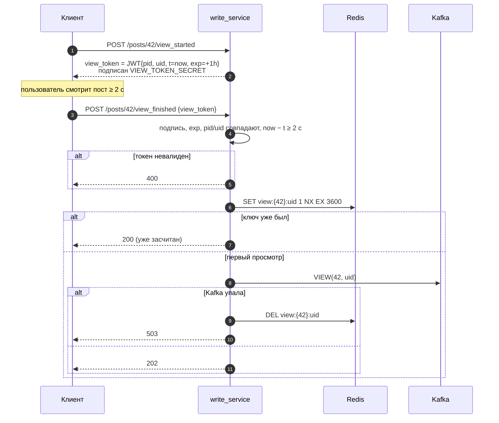
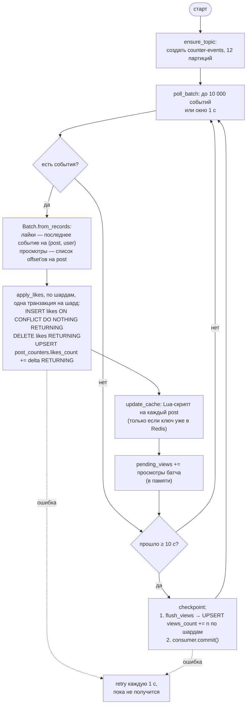
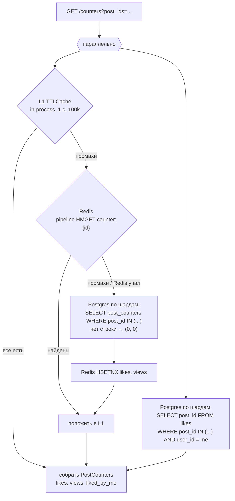
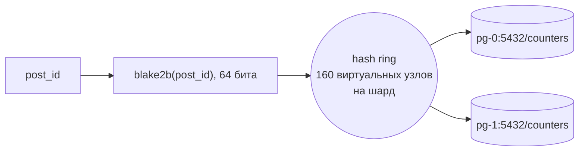
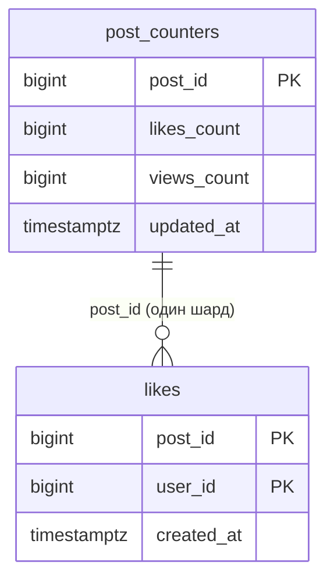
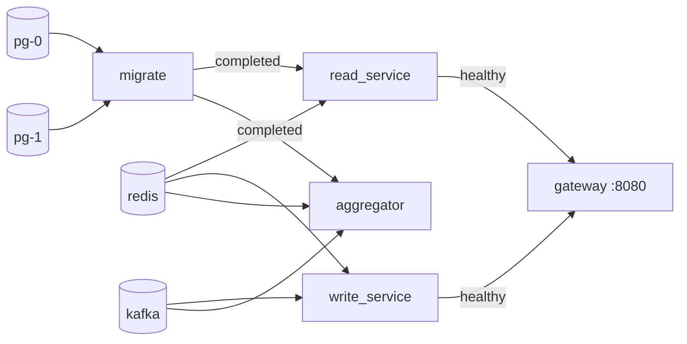

# SIS 2 — счётчик лайков и просмотров

Стек: Python 3.12, FastAPI, aiokafka, redis-py, SQLAlchemy (asyncpg), Alembic, nginx, Kafka (KRaft), Redis, PostgreSQL ×2.
Монорепо на `uv` workspace: `shared` + три сервиса + миграции.

## Архитектура



Принцип — CQRS: запись принимается асинхронно (событие в Kafka, ответ `202`), чтение идёт из многоуровневого кэша.
Счётчики eventually consistent: лайки видны после ближайшего батча (~1 с), просмотры в Redis — тоже, в Postgres — после чекпоинта (~10 с).

| Компонент | Код | Роль |
|---|---|---|
| gateway | [services/gateway/nginx.conf](services/gateway/nginx.conf) | Единственная точка входа, роутинг по URL, лимит 50 r/s + burst 100 на IP (`429`) |
| write_service | [services/write_service](services/write_service) | Аутентификация, токены просмотров, дедуп, публикация событий |
| read_service | [services/read_service](services/read_service) | Отдаёт счётчики: L1 → Redis → Postgres |
| aggregator | [services/aggregator](services/aggregator) | Читает Kafka батчами, пишет в шарды Postgres и обновляет Redis |
| shared | [shared/src/shared](shared/src/shared) | События, модели, ключи Redis, шардинг, JWT, настройки |
| migrate | [infra/postgres](infra/postgres) | `alembic upgrade head` на каждом шарде |

## API

Все запросы — с `Authorization: Bearer <JWT>` (HS256, секрет `JWT_SECRET`, `sub` = id пользователя).

| Метод | Путь | Сервис | Ответ |
|---|---|---|---|
| `PUT` | `/api/v1/posts/{id}/like` | write | `202` |
| `DELETE` | `/api/v1/posts/{id}/like` | write | `202` |
| `POST` | `/api/v1/posts/{id}/view_started` | write | `200 {"view_token": "..."}` |
| `POST` | `/api/v1/posts/{id}/view_finished` | write | `202` засчитан, `200` уже засчитан, `400` токен невалиден / просмотр < 2 с |
| `GET` | `/api/v1/posts/{id}/counters` | read | `{post_id, likes, views, liked_by_me}` |
| `GET` | `/api/v1/counters?post_ids=1,2,3` | read | `{"counters": [...]}`, до 100 id |

Если Kafka недоступна, write-эндпоинты отвечают `503` — клиент повторяет запрос.

## Лайк



Ключ сообщения — `post_id`, поэтому все события одного поста попадают в одну партицию и обрабатываются по порядку.
Повторный лайк или анлайк без лайка безопасны: идемпотентность обеспечивает aggregator через PK `(post_id, user_id)`.

## Просмотр

Просмотр засчитывается, только если между `view_started` и `view_finished` прошло ≥ 2 с, и не чаще раза в час на пару (пост, пользователь).



Токен stateless — серверу не нужно хранить начало просмотра. Если Redis недоступен, дедуп пропускает запрос (fail-open): лучше лишний просмотр, чем ошибка.

## Aggregator



Чекпоинт также выполняется при отзыве партиций (rebalance) и при остановке (SIGTERM/SIGINT).

### Почему счётчики не задваиваются

Offset в Kafka коммитится **только после** записи просмотров в Postgres. После падения aggregator перечитывает события с последнего коммита:

- **Лайки** — `likes` с PK `(post_id, user_id)`: повторный `INSERT` ничего не вставит, `RETURNING` вернёт пусто, `delta = 0`. В Redis пишется абсолютное значение `likes_count` из Postgres.
- **Просмотры в Postgres** — `pending_views` жили в памяти и потерялись вместе с процессом, поэтому повторное чтение запишет их ровно один раз.
- **Просмотры в Redis** — Lua-скрипт хранит в хэше поле `offset` и прибавляет только события с offset больше сохранённого. Все события поста лежат в одной партиции, так что offset'ы монотонны.

```lua
-- KEYS[1] = counter:{post_id}, ARGV[1] = likes или '', ARGV[2..] = offset'ы просмотров
if not EXISTS(key) then return 0 end      -- не греем кэш сами, это делает read_service
if likes ~= '' then HSET likes end
views = count(offset > key.offset)
HINCRBY views; HSET offset = max(offset)
```

## Чтение



- L1 гасит горячие посты: при всплеске трафика на один пост Redis получает не больше запроса в секунду на инстанс.
- `HSETNX` не перезапишет значение, если aggregator успел обновить ключ между чтением из Postgres и заполнением.
- Ошибки Redis не валят запрос — сервис деградирует до Postgres.
- `liked_by_me` всегда читается из Postgres (персональные данные не кэшируются).

## Шардирование Postgres



- Обе таблицы шардируются по `post_id` — все данные поста лежат на одном шарде, транзакции не распределённые.
- Шарды задаются списком `DATABASE_URLS`; имя узла на кольце — `host:port/db`. Consistent hashing: при добавлении шарда переезжает ~1/N постов.
- `ShardedDatabase.map_shards` группирует `post_ids` по шардам и выполняет запросы к ним параллельно.
- Миграции ([env.py](infra/postgres/migrations/env.py)) последовательно применяются к каждому шарду под `pg_advisory_xact_lock`.

## Данные



| Redis-ключ | Тип | TTL | Назначение |
|---|---|---|---|
| `counter:{post_id}` | hash `likes`, `views`, `offset` | нет, вытеснение `allkeys-lru` (512 МБ) | кэш счётчиков |
| `view:{post_id}:{user_id}` | string | 3600 с | дедуп просмотров |

Фигурные скобки — hash tag: при переходе на Redis Cluster ключи одного поста окажутся в одном слоте.
Redis работает как чистый кэш (`save ""`, `appendonly no`) — источник истины Postgres + Kafka.

Событие в Kafka ([events.py](shared/src/shared/events.py)):

```json
{"event_id": "uuid", "type": "like | unlike | view", "post_id": 42, "user_id": 7, "timestamp": 1761800000000}
```

## Запуск

```bash
cd sis2
cp .env.example .env        # POSTGRES_PASSWORD, VIEW_TOKEN_SECRET, JWT_SECRET
docker compose up --build
```

Порядок старта задан через `depends_on` + healthcheck'и:



Наружу открыт только `:8080`. Compose собран из файлов в [docker-ymls](docker-ymls), все Python-образы — из одного [python.Dockerfile](docker-ymls/dockerfiles/python.Dockerfile) с аргументами `PACKAGE` и `SRC`.

### Проверка руками

```bash
TOKEN=$(uv run --with pyjwt python -c "import jwt; print(jwt.encode({'sub': '7'}, 'change-me-jwt', algorithm='HS256'))")
H="Authorization: Bearer $TOKEN"

curl -i -X PUT -H "$H" localhost:8080/api/v1/posts/42/like

VT=$(curl -s -X POST -H "$H" localhost:8080/api/v1/posts/42/view_started | jq -r .view_token)
sleep 2
curl -i -X POST -H "$H" -H 'Content-Type: application/json' \
  -d "{\"view_token\": \"$VT\"}" localhost:8080/api/v1/posts/42/view_finished

sleep 1
curl -s -H "$H" 'localhost:8080/api/v1/counters?post_ids=42,43' | jq
```

## Настройки

Общие переменные (из [services.yml](docker-ymls/services.yml)): `DATABASE_URLS` (через запятую), `REDIS_URL`, `KAFKA_BOOTSTRAP_SERVERS`, `KAFKA_TOPIC`, `JWT_SECRET`.

| Сервис | Переменная | По умолчанию |
|---|---|---|
| write | `VIEW_TOKEN_SECRET` | — |
| write | `VIEW_TOKEN_TTL_SECONDS` | 3600 |
| write | `VIEW_MIN_SECONDS` | 2.0 |
| write | `PUBLISH_TIMEOUT_SECONDS` | 2.0 |
| read | `DB_POOL_SIZE` | 20 |
| read | `LOCAL_CACHE_TTL_SECONDS` / `LOCAL_CACHE_SIZE` | 1.0 / 100 000 |
| read | `MAX_BATCH_POSTS` | 100 |
| aggregator | `KAFKA_GROUP_ID` / `KAFKA_TOPIC_PARTITIONS` | aggregator / 12 |
| aggregator | `BATCH_WINDOW_SECONDS` / `BATCH_MAX_EVENTS` | 1.0 / 10 000 |
| aggregator | `FLUSH_INTERVAL_SECONDS` | 10.0 |
| aggregator | `RETRY_BACKOFF_SECONDS` | 1.0 |
| aggregator | `DB_POOL_SIZE` | 5 |
