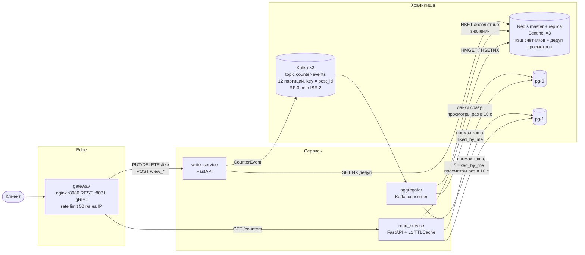
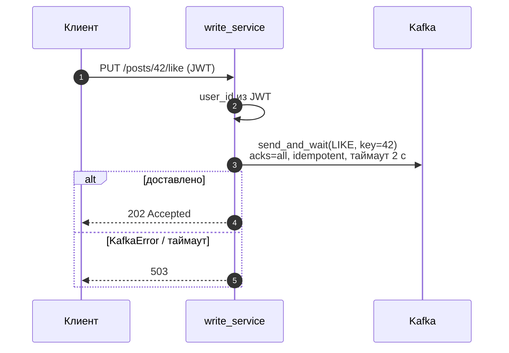
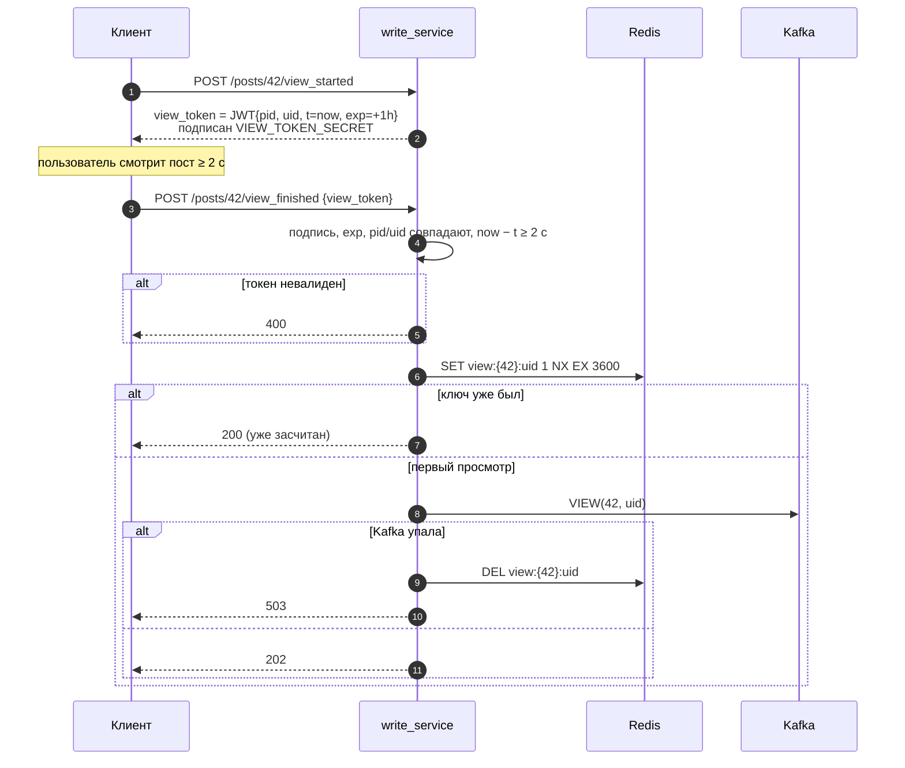
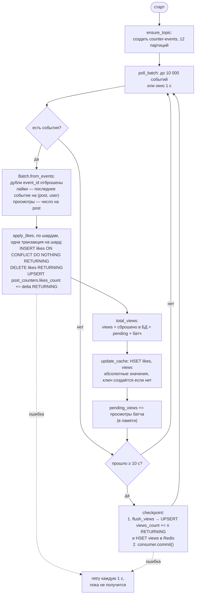
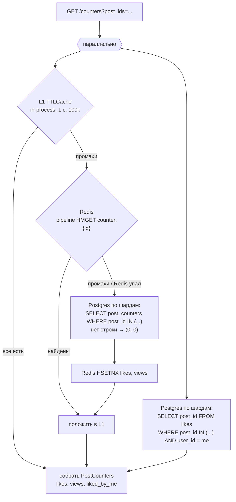
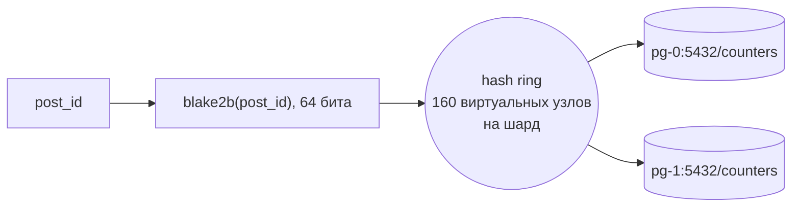
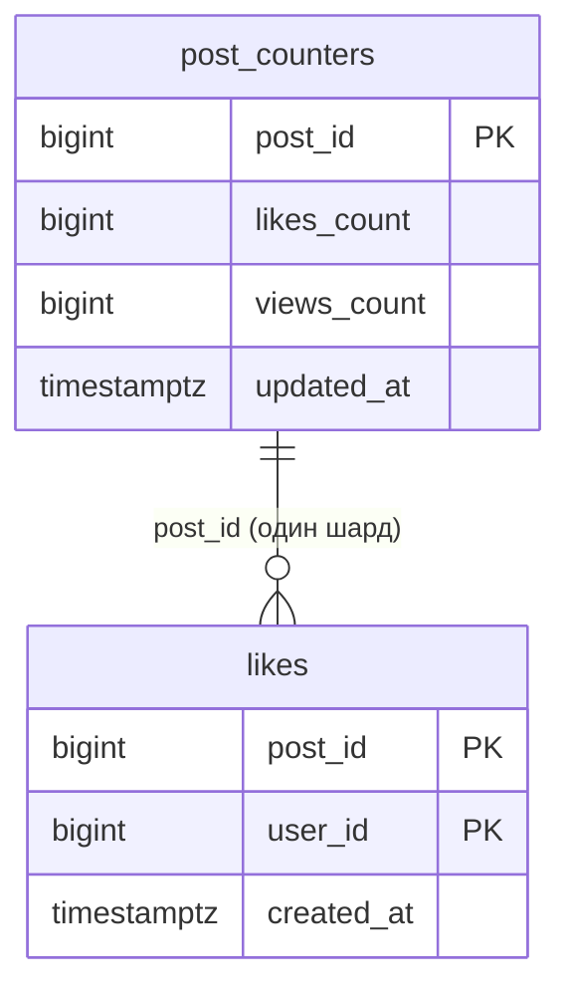
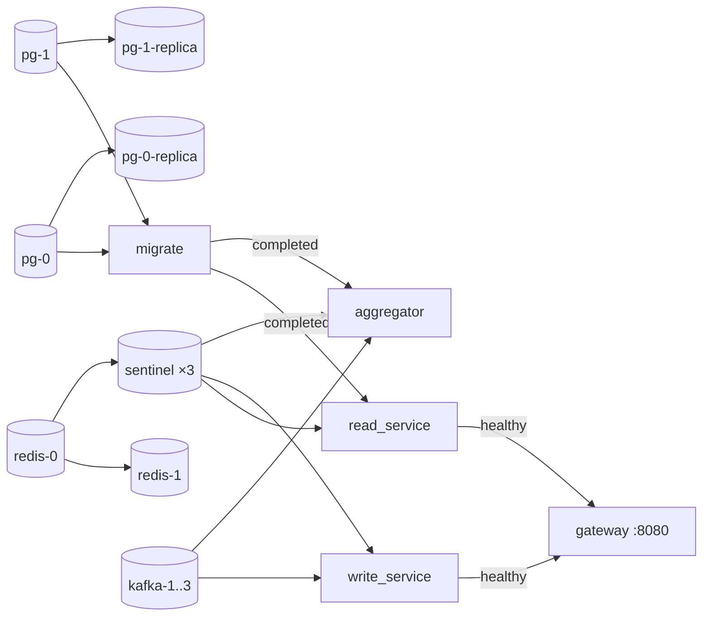

# SIS 2 — счётчик лайков и просмотров

Стек: Python 3.12, FastAPI, aiokafka, redis-py, SQLAlchemy (asyncpg), Alembic, nginx, Kafka (KRaft) ×3, Redis + реплика + Sentinel ×3, PostgreSQL ×2 шарда, у каждого потоковая реплика.
Монорепо на `uv` workspace: `shared` + три сервиса + миграции.

## Архитектура



Принцип — CQRS: запись принимается асинхронно (событие в Kafka, ответ `202`), чтение идёт из многоуровневого кэша.
Счётчики eventually consistent: лайки видны после ближайшего батча (~1 с), просмотры в Redis — тоже, в Postgres — после чекпоинта (~10 с).

| Компонент | Код | Роль |
|---|---|---|
| gateway | [services/gateway/nginx.conf](services/gateway/nginx.conf) | Единственная точка входа: REST на `:8080`, gRPC (h2c) на `:8081`, лимит 50 r/s + burst 100 на IP (`429`) |
| write_service | [services/write_service](services/write_service) | Аутентификация, токены просмотров, дедуп, публикация событий |
| read_service | [services/read_service](services/read_service) | Отдаёт счётчики: L1 → Redis → Postgres |
| aggregator | [services/aggregator](services/aggregator) | Читает Kafka батчами, пишет в шарды Postgres и обновляет Redis |
| shared | [shared/src/shared](shared/src/shared) | События, модели, ключи Redis, шардинг, JWT, настройки |
| migrate | [infra/postgres](infra/postgres) | `alembic upgrade head` на каждом шарде |

## API

Все запросы — с `Authorization: Bearer <JWT>` (HS256, секрет `JWT_SECRET`, `sub` = id пользователя).

| Метод | Путь | Сервис | Ответ |
|---|---|---|---|
| `PUT` | `/api/v1/posts/{id}/like` | write | `202` |
| `DELETE` | `/api/v1/posts/{id}/like` | write | `202` |
| `POST` | `/api/v1/posts/{id}/view_started` | write | `200 {"view_token": "..."}` |
| `POST` | `/api/v1/posts/{id}/view_finished` | write | `202` засчитан, `200` уже засчитан, `400` токен невалиден / просмотр < 2 с |
| `GET` | `/api/v1/posts/{id}/counters` | read | `{post_id, likes, views, liked_by_me}` |
| `GET` | `/api/v1/counters?post_ids=1,2,3` | read | `{"counters": [...]}`, до 100 id |

Если Kafka недоступна, write-эндпоинты отвечают `503` — клиент повторяет запрос.
В ответе чтения у каждого поста есть поле `unavailable`. Оно `true`, только если поста нет в Redis, а его шард и реплика шарда недоступны: тогда `likes` и `views` равны 0 и верить им нельзя. Остальные посты пачки отдаются как обычно.
Необязательный заголовок `Idempotency-Key: <UUID>` у записи делает повтор безопасным: событие получит тот же `event_id`, и aggregator посчитает его один раз.

### gRPC

Те же операции доступны по gRPC через `:8081`: `CounterWriteService` (`Like`, `Unlike`, `ViewStarted`, `ViewFinished`) и `CounterReadService` (`GetCounters`, `BatchGetCounters`).
Контракт — [counters.proto](shared/src/shared/proto/counters.proto), код генерирует `make proto`. gRPC-сервер запускается в `lifespan` того же процесса, что и FastAPI (порт `50051`), и работает через те же сервисные объекты.

- JWT передаётся в metadata `authorization`, ключ идемпотентности — в поле `idempotency_key`.
- Сервер ограничивает вызовы Redis, Kafka и Postgres оставшимся до дедлайна клиента временем и отвечает `DEADLINE_EXCEEDED`.
- Клиент ([load/client.py](load/client.py)) повторяет `UNAVAILABLE` через `retryPolicy` с экспоненциальным backoff и `retryThrottling`.

Обоснование выбора протокола, схема ретраев и замеры против REST — в [REPORT.md](REPORT.md).

## Лайк



Ключ сообщения — `post_id`, поэтому все события одного поста попадают в одну партицию и обрабатываются по порядку.
Повторный лайк или анлайк без лайка безопасны: идемпотентность обеспечивает aggregator через PK `(post_id, user_id)`.

## Просмотр

Просмотр засчитывается, только если между `view_started` и `view_finished` прошло ≥ 2 с, и не чаще раза в час на пару (пост, пользователь).



Токен stateless — серверу не нужно хранить начало просмотра. Если Redis недоступен, дедуп пропускает запрос (fail-open): лучше лишний просмотр, чем ошибка.

## Aggregator



Чекпоинт также выполняется при отзыве партиций (rebalance) и при остановке (SIGTERM/SIGINT).

### Почему счётчики не задваиваются

Offset в Kafka коммитится **только после** записи просмотров в Postgres. После падения aggregator перечитывает события с последнего коммита:

- **Лайки** — `likes` с PK `(post_id, user_id)`: повторный `INSERT` ничего не вставит, `RETURNING` вернёт пусто, `delta = 0`. В Redis пишется абсолютное значение `likes_count` из Postgres.
- **Просмотры в Postgres** — `pending_views` жили в памяти и потерялись вместе с процессом, поэтому повторное чтение запишет их ровно один раз.
- **Просмотры в Redis** — aggregator пишет не приращение, а абсолютное значение: `views = сброшено в Postgres + pending + батч`. Сброшенную часть он знает из `RETURNING` при флаше (или читает из БД, LRU на 200k постов). Повторная запись того же значения ничего не ломает, поэтому переигровка после падения безопасна.
- **Повторная отправка клиентом** (ретрай после потерянного ack) — это новое сообщение, но с тем же `event_id`. Aggregator держит LRU последних `event_id` и пропускает повтор. После рестарта LRU заново заполняется при переигровке с закоммиченного offset.

### Почему кэш не застревает со старым значением

Aggregator записывает `likes` и `views` в Redis всегда, даже если ключа ещё нет. read_service при промахе дописывает из Postgres только **отсутствующие** поля через `HSETNX`. Поэтому:

- если aggregator записал раньше — `HSETNX` ничего не перезапишет;
- если read_service записал раньше устаревшее значение из БД — aggregator перезапишет его абсолютным.

Просмотры, которые ещё не сброшены в Postgres, сразу попадают в Redis, и чтение из БД их не потеряет. Счётчики не имеют TTL, а Redis работает с `maxmemory-policy volatile-lru`: при нехватке памяти вытесняются только ключи дедупа, счётчики остаются. Ключ может пропасть только при потере данных Redis, например если при переключении на реплику не успели доехать последние записи. Тогда значение исправится при следующем событии по посту или флаше (≤ 10 с).

При отзыве партиций (rebalance) aggregator забывает кэш сброшенных значений: эти посты теперь пишет другой инстанс.

## Чтение



- L1 гасит горячие посты: при всплеске трафика на один пост Redis получает не больше запроса в секунду на инстанс.
- `HSETNX` дописывает только отсутствующие поля и не перезапишет то, что записал aggregator.
- Ошибки Redis не валят запрос — сервис деградирует до Postgres.
- `liked_by_me` всегда читается из Postgres (персональные данные не кэшируются).
- Если primary шарда не ответил за 0.5 с, чтение идёт с его реплики, и следующие 5 с primary не опрашивается ([shared/db.py](shared/src/shared/db.py)). Если недоступна и реплика, `liked_by_me = false`, а посты, которых нет в Redis, приходят с `unavailable = true`.

## Шардирование Postgres



- Обе таблицы шардируются по `post_id` — все данные поста лежат на одном шарде, транзакции не распределённые.
- Шарды задаются списком `DATABASE_URLS`; имя узла на кольце — `host:port/db`. Consistent hashing: при добавлении шарда переезжает ~1/N постов.
- `ShardedDatabase.map_shards` группирует `post_ids` по шардам и выполняет запросы к ним параллельно.
- Миграции ([env.py](infra/postgres/migrations/env.py)) последовательно применяются к каждому шарду под `pg_advisory_xact_lock`.

## Данные



| Redis-ключ | Тип | TTL | Назначение |
|---|---|---|---|
| `counter:{post_id}` | hash `likes`, `views` | нет, не вытесняется (`volatile-lru`) | кэш счётчиков |
| `view:{post_id}:{user_id}` | string | 3600 с | дедуп просмотров |

Фигурные скобки — hash tag: при переходе на Redis Cluster ключи одного поста окажутся в одном слоте.
Redis работает как чистый кэш (`save ""`, `appendonly no`) — источник истины Postgres + Kafka.

Событие в Kafka ([events.py](shared/src/shared/events.py)):

```json
{"event_id": "uuid", "type": "like | unlike | view", "post_id": 42, "user_id": 7, "timestamp": 1761800000000}
```

## Запуск

```bash
cd sis2
cp .env.example .env        # POSTGRES_PASSWORD, VIEW_TOKEN_SECRET, JWT_SECRET
docker compose up --build
```

Порядок старта задан через `depends_on` + healthcheck'и:



Наружу открыты только `:8080` (REST) и `:8081` (gRPC).

### Отказоустойчивость

| Компонент | Как устроено | Что будет при падении узла |
|---|---|---|
| Kafka | 3 узла KRaft (broker + controller), у топика 12 партиций с фактором репликации 3, `min.insync.replicas=2`, producer с `acks=all` | Кворум контроллеров (2 из 3) выбирает новых лидеров партиций примерно за 3 с (`broker.session.timeout.ms=3000`). События не теряются |
| Redis | `redis-0` мастер, `redis-1` реплика, 3 Sentinel с кворумом 2 | Sentinel повышает реплику через ~2 с (`down-after-milliseconds 2000`), сервисы переподключаются к новому мастеру через Sentinel. Пока мастера нет, чтение идёт в Postgres, дедуп пропускает запросы, aggregator ретраит |
| Postgres | 2 шарда, у каждого потоковая реплика (`pg_basebackup` + `standby.signal`) | Запись ждёт в Kafka, aggregator ретраит, пока primary не вернётся. Чтение идёт с реплики. Если лежат и primary, и реплика, посты шарда, которых нет в Redis, отдаются с `unavailable = true` |

Сервисы подключаются к Redis через Sentinel ([redis_client.py](shared/src/shared/redis_client.py)) с таймаутом сокета 0.5 с, к Kafka — по списку всех брокеров.
Проверка под нагрузкой — [load/failover.py](load/failover.py): `uv run python load/failover.py kafka-2` или `redis-0` убивает узел посреди потока лайков и сверяет, что ничего не потеряно и не задвоено. Compose собран из файлов в [docker-ymls](docker-ymls), все Python-образы — из одного [python.Dockerfile](docker-ymls/dockerfiles/python.Dockerfile) с аргументами `PACKAGE` и `SRC`.

### Проверка руками

```bash
set -a; source .env; set +a
TOKEN=$(uv run -q python -c "import jwt, os; print(jwt.encode({'sub': '7'}, os.environ['JWT_SECRET'], algorithm='HS256'))")
H="Authorization: Bearer $TOKEN"

curl -i -X PUT -H "$H" localhost:8080/api/v1/posts/42/like

VT=$(curl -s -X POST -H "$H" localhost:8080/api/v1/posts/42/view_started | jq -r .view_token)
sleep 2
curl -i -X POST -H "$H" -H 'Content-Type: application/json' \
  -d "{\"view_token\": \"$VT\"}" localhost:8080/api/v1/posts/42/view_finished

sleep 1
curl -s -H "$H" 'localhost:8080/api/v1/counters?post_ids=42,43' | jq
```

## Настройки

Общие переменные (из [services.yml](docker-ymls/services.yml)): `DATABASE_URLS` (через запятую), `REDIS_URL` (`redis+sentinel://sentinel-1:26379,.../counters` — список Sentinel'ов и имя мастера), `KAFKA_BOOTSTRAP_SERVERS` (через запятую), `KAFKA_TOPIC`, `JWT_SECRET`.

| Сервис | Переменная | По умолчанию |
|---|---|---|
| write | `VIEW_TOKEN_SECRET` | — |
| write | `VIEW_TOKEN_TTL_SECONDS` | 3600 |
| write | `VIEW_MIN_SECONDS` | 2.0 |
| write | `PUBLISH_TIMEOUT_SECONDS` | 2.0 |
| write | `CHAOS_ACK_LOSS_RATE` — доля имитированных потерь ack Kafka, только для [load/chaos.py](load/chaos.py) | 0 |
| write, read | `GRPC_PORT` | 50051 |
| read | `DB_POOL_SIZE` | 20 |
| read | `LOCAL_CACHE_TTL_SECONDS` / `LOCAL_CACHE_SIZE` | 1.0 / 100 000 |
| read | `MAX_BATCH_POSTS` | 100 |
| read | `DATABASE_REPLICA_URLS` — реплики шардов в том же порядке, что `DATABASE_URLS` | — |
| read | `DB_TIMEOUT_SECONDS` — сколько ждать primary шарда, прежде чем идти в реплику | 0.5 |
| aggregator | `KAFKA_GROUP_ID` / `KAFKA_TOPIC_PARTITIONS` / `KAFKA_REPLICATION_FACTOR` | aggregator / 12 / 3 |
| aggregator | `BATCH_WINDOW_SECONDS` / `BATCH_MAX_EVENTS` | 1.0 / 10 000 |
| aggregator | `FLUSH_INTERVAL_SECONDS` | 10.0 |
| aggregator | `RETRY_BACKOFF_SECONDS` | 1.0 |
| aggregator | `SEEN_EVENTS_SIZE` — размер LRU для дедупа по `event_id` | 200 000 |
| aggregator | `FLUSHED_VIEWS_SIZE` — LRU сброшенных в БД значений просмотров | 200 000 |
| aggregator | `DB_POOL_SIZE` | 5 |
