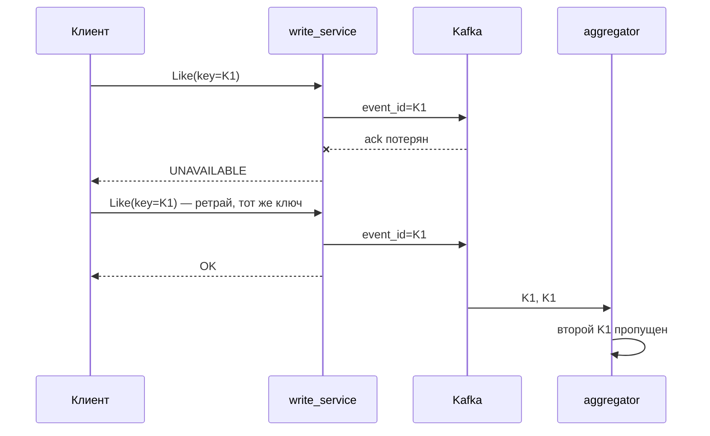

# SIS 2 — счётчик лайков и просмотров на gRPC

**Коротко.** В сервис из SIS 1 добавлен gRPC-интерфейс, REST оставлен рядом для сравнения. На проводе gRPC в 2–8 раз компактнее. По медиане latency протоколы равны, по хвостам выигрывает gRPC. Ретраи с одним ключом идемпотентности держат счётчики точными, даже когда 10% подтверждений от Kafka теряются.

> Реализация на Python, а не на Java. Сервис из SIS 1 уже написан на Python, и REST с gRPC живут в одном процессе поверх одной бизнес-логики. Поэтому сравнивается именно протокол, а не два разных рантайма.

---

## Почему gRPC

Лента — основной потребитель счётчиков: она запрашивает их пачками по 100 постов при ~44k RPS. Поэтому важно, сколько байт уходит в сеть и как ведёт себя один долгоживущий канал.

- **protobuf** в 4–6 раз меньше JSON на тех же данных.
- **HTTP/2** держит одно соединение на много параллельных запросов. HPACK сжимает заголовок с JWT, который иначе уходил бы текстом в каждом запросе.
- **Дедлайны, ретраи и статусы** встроены в протокол, их не нужно изобретать.
- **WebSocket** не нужен: счётчики забираются по запросу, задержка до 2 с допустима, push никто не просит.

## Что сделано

| | Как |
|---|---|
| **Контракт** | [counters.proto](shared/src/shared/proto/counters.proto): `CounterWriteService` (`Like`, `Unlike`, `ViewStarted`, `ViewFinished`) и `CounterReadService` (`GetCounters`, `BatchGetCounters`). Gateway отдаёт gRPC на `:8081` |
| **Идемпотентность** | Клиент шлёт `idempotency_key`, он становится `event_id` события в Kafka. Aggregator помнит последние 200k id и пропускает повторы. В REST то же делает заголовок `Idempotency-Key` |
| **Таймауты** | Дедлайн клиента: запись 1 с, чтение 300 мс. Сервер не ждёт Redis, Kafka и БД дольше, чем клиент готов ждать ответ, и возвращает `DEADLINE_EXCEEDED` |
| **Ретраи** | `retryPolicy`: до 4 попыток, пауза 50 мс × 2ⁿ со случайным разбросом, повторяется только `UNAVAILABLE`. `retryThrottling` выключает ретраи при массовом сбое |

Как это выглядит при потерянном подтверждении от Kafka:



Одна находка по ходу работы: в grpcio 1.85.1 поле `timeout` в service config ломается, и любой вызов сразу получает `DEADLINE_EXCEEDED`. Поэтому дедлайн передаётся в каждом вызове.

---

## Замеры

**Стенд:** Apple M4, Docker с 10 CPU и 8 ГБ. Python 3.12, grpcio 1.85, FastAPI + uvicorn (1 воркер), Kafka, Redis, 2 шарда Postgres. k6 работает внутри docker-сети с постоянным RPS по 30 с на прогон, кэши прогреты.

### Размер сообщения

| Сообщение | protobuf | JSON | разница |
|---|---|---|---|
| Счётчики одного поста | 12 B | 67 B | **5.6×** |
| 100 id в запросе | 400 B | 888 B | 2.2× |
| Ответ на 100 постов | 1.4 KB | 6.7 KB | **4.6×** |
| ViewFinished (почти весь — JWT) | 168 B | 177 B | 1.1× |

### Latency и трафик

Трафик считается вместе с заголовками и фреймингом, то есть всё, что прошло по TCP.

| Сценарий | | p50 | p99 | max | отправлено | получено |
|---|---|---|---|---|---|---|
| 1 пост, 500 RPS | REST | 0.81 мс | 10.1 мс | 74 мс | 220 B | 181 B |
| | **gRPC** | 0.77 мс | **1.9 мс** | **30 мс** | **69 B** | **86 B** |
| 100 постов, 200 RPS | REST | 1.92 мс | 25.2 мс | 104 мс | 707 B | 5830 B |
| | **gRPC** | 1.92 мс | 23.7 мс | **51 мс** | **272 B** | **759 B** |
| like, 300 RPS | REST | 6.08 мс | 9.8 мс | 66 мс | 236 B | 98 B |
| | **gRPC** | 6.17 мс | 9.5 мс | **47 мс** | **71 B** | **84 B** |

Ошибок не было ни в одном прогоне.

### Ретраи под сбоем

write_service запущен в режиме, где 10% или 30% подтверждений от Kafka «теряются»: событие записано, а клиент получает ошибку. 100 пользователей лайкают и смотрят один пост.

| Сбоев | Как ретраим | Успешных вызовов | Просмотров (нужно 100) |
|---|---|---|---|
| 10% | не ретраим | 92% | 100 |
| 10% | сами, с новым ключом на каждую попытку | 100% | **115** ❌ |
| 10% | `retryPolicy`, один ключ | **100%** | **100** ✅ |
| 30% | не ретраим | 67% | 100 |
| 30% | сами, с новым ключом | 100% | **137** ❌ |
| 30% | `retryPolicy`, один ключ | 99% / 82% лайков | **100** ✅ |

---

## Выводы

- **Трафик — главный выигрыш.** Ответ ленты в 7–8 раз меньше. При 44k RPS чтений это ~33 МБ/с вместо ~250 МБ/с. Запросы в 3 раза меньше в основном благодаря HPACK: JWT уходит в сеть один раз на соединение, а не с каждым запросом.
- **Медиана не меняется.** Время уходит на Redis, Postgres и подтверждение Kafka (~6 мс на лайк), а не на протокол. Хвосты у gRPC короче: на одиночном чтении p99 в 5 раз ниже. На пачках p99 сравнялся, там всё решает запрос к БД за `liked_by_me`.
- **Ретраи без идемпотентности вредны.** Ошибки они скрывают, но просмотры завышаются на 15–37%, а в SIS 1 допустимая погрешность меньше 1%.
- **С одним ключом ретраи безопасны.** При 10% сбоев пользователь ошибок не видит, счётчики точные.
- **При 30% сбоев ретраи отключает `retryThrottling`, и это правильно.** Когда сервис серьёзно болен, повторы только добивают его. Часть лайков вернула ошибку, но ни один не посчитан дважды.

## Как повторить

```bash
docker compose up --build -d
uv run python load/payload.py                     # размеры сообщений
./load/bench.sh                                   # latency и трафик → load/results/

CHAOS_ACK_LOSS_RATE=0.1 docker compose up -d --wait write_service
uv run python load/chaos.py none|naive|grpc       # ретраи под сбоем
docker compose up -d --wait write_service         # вернуть как было
```
