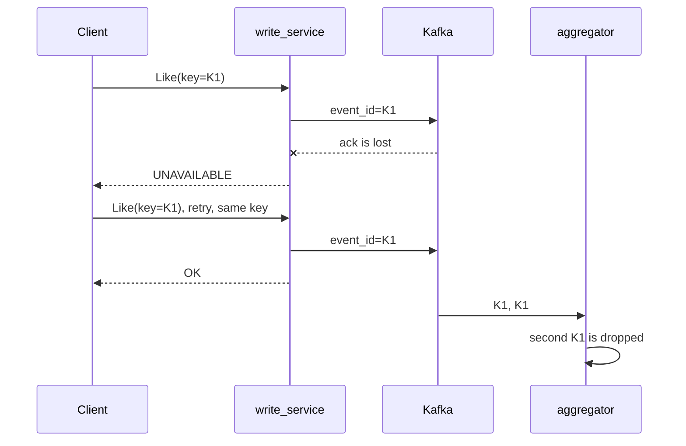

# SIS 2 — Like and View Counter on gRPC

**In short.** We added a gRPC interface to the service from SIS 1. REST is still there, so we can compare them. On the network, gRPC is 2–8 times smaller. The median latency is the same. The slowest requests are faster with gRPC. Retries with one idempotency key keep the counters exact, even when 10% of Kafka acks are lost.

> The code is in Python, not Java. The service from SIS 1 is in Python. REST and gRPC run in one process on the same business logic. So we compare only the protocol, not two different runtimes.

---

## Why gRPC

The feed is the main user of the counters. It asks for 100 posts at a time, at about 44k RPS. So the number of bytes on the network matters, and one long connection must work well.

- **protobuf** is 4–6 times smaller than JSON for the same data.
- **HTTP/2** keeps one connection for many requests at the same time. HPACK makes the JWT header small. Without it, the JWT goes as text in every request.
- **Deadlines, retries and status codes** are part of the protocol. We do not need to make them ourselves.
- **WebSocket** is not needed. Clients ask for counters when they need them. A delay up to 2 s is OK. Nobody needs push.

## What we did

| | How |
|---|---|
| **Contract** | [counters.proto](shared/src/shared/proto/counters.proto): `CounterWriteService` (`Like`, `Unlike`, `ViewStarted`, `ViewFinished`) and `CounterReadService` (`GetCounters`, `BatchGetCounters`). The gateway serves gRPC on `:8081` |
| **Idempotency** | The client sends `idempotency_key`. It becomes the `event_id` of the Kafka event. The aggregator remembers the last 200k ids and drops repeats. In REST, the header `Idempotency-Key` does the same |
| **Timeouts** | Client deadline: 1 s for writes, 300 ms for reads. The server does not wait for Redis, Kafka or the DB longer than the client waits. Then it answers `DEADLINE_EXCEEDED` |
| **Retries** | `retryPolicy`: up to 4 tries, pause 50 ms × 2ⁿ with a random part, only for `UNAVAILABLE`. `retryThrottling` turns retries off when many calls fail |

This is what happens when a Kafka ack is lost:



One thing we found: in grpcio 1.85.1, the `timeout` field in the service config is broken. Every call gets `DEADLINE_EXCEEDED` at once. So we pass the deadline in every call.

---

## Measurements

**Test setup:** Apple M4, Docker with 10 CPU and 8 GB. Python 3.12, grpcio 1.85, FastAPI + uvicorn (1 worker), Kafka ×3, Redis with a replica and Sentinel, 2 Postgres shards with replicas. k6 runs inside the Docker network with a fixed RPS for 30 s per run. Caches are warm.

### Message size

| Message | protobuf | JSON | difference |
|---|---|---|---|
| Counters of one post | 12 B | 67 B | **5.6×** |
| 100 ids in a request | 400 B | 888 B | 2.2× |
| Answer for 100 posts | 1.4 KB | 6.7 KB | **4.6×** |
| ViewFinished (mostly the JWT) | 168 B | 177 B | 1.1× |

### Latency and traffic

Traffic includes headers and framing: everything that goes over TCP.

| Case | | p50 | p99 | max | sent | received |
|---|---|---|---|---|---|---|
| 1 post, 500 RPS | REST | 0.81 ms | 10.1 ms | 74 ms | 220 B | 181 B |
| | **gRPC** | 0.77 ms | **1.9 ms** | **30 ms** | **69 B** | **86 B** |
| 100 posts, 200 RPS | REST | 1.92 ms | 25.2 ms | 104 ms | 707 B | 5830 B |
| | **gRPC** | 1.92 ms | 23.7 ms | **51 ms** | **272 B** | **759 B** |
| like, 300 RPS | REST | 6.08 ms | 9.8 ms | 66 ms | 236 B | 98 B |
| | **gRPC** | 6.17 ms | 9.5 ms | **47 ms** | **71 B** | **84 B** |

No run had errors. We made this table on a setup with one Kafka broker and one Redis. On the setup with replicas (14 containers), the median is the same, about 0.85 ms. But p99 for one post changes from 10 to 110 ms between runs, for both protocols.

### Retries when things fail

In this test, write_service "loses" 10% or 30% of Kafka acks: the event is saved, but the client gets an error. 100 users like and view one post.

| Failures | How we retry | Calls OK | Views (must be 100) |
|---|---|---|---|
| 10% | no retry | 92% | 100 |
| 10% | by hand, new key every try | 100% | **115** ❌ |
| 10% | `retryPolicy`, one key | **100%** | **100** ✅ |
| 30% | no retry | 67% | 100 |
| 30% | by hand, new key | 100% | **137** ❌ |
| 30% | `retryPolicy`, one key | 99% / 82% of likes | **100** ✅ |

### A Kafka or Redis node dies

Kafka has 3 nodes with replication factor 3. Redis has a master, a replica and 3 Sentinels. [load/failover.py](load/failover.py) sends 30 likes per second to 12 posts. At second 3, it kills a node with `docker kill`.

| Killed | OK for the client | Counted | Client errors | Lost / double |
|---|---|---|---|---|
| Kafka broker | 242 of 300 | **300** | `DEADLINE_EXCEEDED` for about 2 s, while Kafka picks new partition leaders | **none** |
| Redis master | 300 of 300 | **300** | 4 of 100 reads were slower than 300 ms, while Sentinel made the replica the master | **none** |

We also tested reads of posts that are not in Redis when a Postgres shard dies:

| What is down | First request | Next requests | Result |
|---|---|---|---|
| shard primary | 876 ms (waits for the primary timeout) | 7 ms (goes to the replica at once) | data is right, `liked_by_me` is there |
| primary and replica | 514 ms | 28 ms | posts of this shard have `unavailable = true`, other posts are fine, the request does not fail |

The likes with a client error still arrived. The producer waited for the new leader and sent them. A retry with the same `idempotency_key` would be safe too.

---

## Conclusions

- **Traffic is the main win.** The feed answer is 7–8 times smaller. At 44k RPS of reads, this is about 33 MB/s instead of about 250 MB/s. Requests are 3 times smaller, mostly because of HPACK: the JWT goes over the network once per connection, not with every request.
- **The median does not change.** The time goes to Redis, Postgres and the Kafka ack (about 6 ms per like), not to the protocol. On the clean setup, the slowest requests are faster with gRPC: p99 for one post is 5 times lower. But p99 depends a lot on other work on the machine. On the setup with replicas, some runs are better for REST, some for gRPC. So this win is not final. For 100 posts, p99 is the same: the DB query for `liked_by_me` decides it.
- **Retries without idempotency are bad.** They hide errors, but views go up by 15–37%. In SIS 1, the allowed error is less than 1%.
- **With one key, retries are safe.** With 10% failures, the user sees no errors, and the counters are exact.
- **With 30% failures, `retryThrottling` turns retries off, and this is right.** When the service is very sick, retries only make it worse. Some likes got an error, but no like was counted twice.

## How to repeat

```bash
docker compose up --build -d
set -a; source .env; set +a                       # scripts need JWT_SECRET
uv run python load/payload.py                     # message sizes
./load/bench/run.sh                               # latency and traffic → load/results/bench/

CHAOS_ACK_LOSS_RATE=0.1 docker compose up -d --wait write_service
uv run python load/chaos.py none|naive|grpc       # retries when acks are lost
docker compose up -d --wait write_service         # back to normal

uv run python load/failover.py kafka-2            # a Kafka broker dies
uv run python load/failover.py redis-0            # the Redis master dies (use the current master)
```
